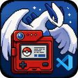
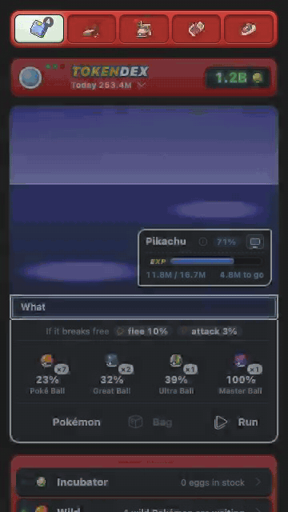
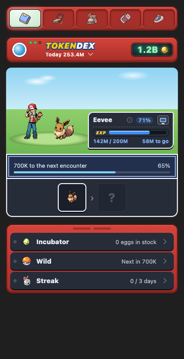
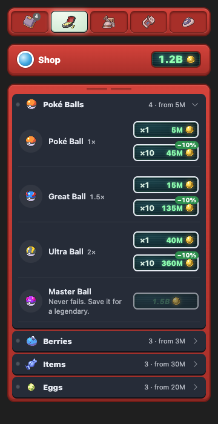
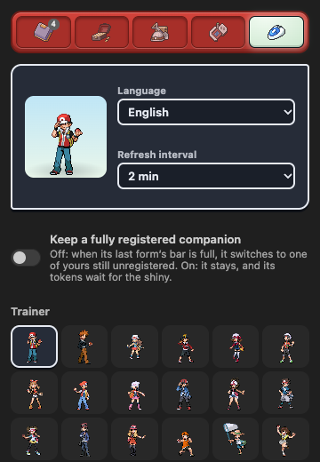
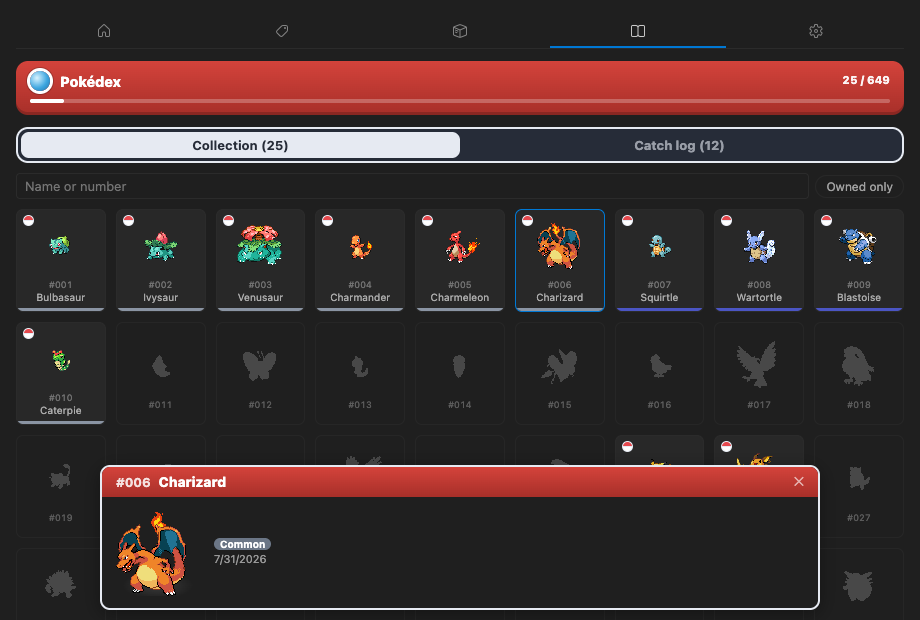

# Tokendex

**Your AI coding tokens hatch, raise and catch Pokémon — right inside VS Code.**

 

<em>A wild Dratini appeared. 23% with a Poké Ball, 39% with an Ultra — or the Master Ball never fails.</em>

 

You already burn millions of tokens a day in Claude Code, Codex, Gemini and friends.
**Tokendex reads those local logs — nothing is uploaded, ever — and turns the spend you
already made into a game**: pick a starter, and every token it sees is experience that
registers its species and evolves it through its actual evolution line, while wild Pokémon
walk into your editor as you code. Throw a ball. Watch the wobbles. Fill the Pokédex.

Underneath the game sits a precise, fast usage tracker: today's tokens and cost, this
month's, official rate-limit windows as live bars, and a per-CLI breakdown with burn rate.

## The game

- 📈 **Raise** — choose a starter from generations 1–5, then any species you have obtained
  or an egg (a free one a day, up to three; 5M tokens to hatch). The tokens your companion
  sees fill its species' bar: a full bar registers it in the Pokédex and evolves it into the
  next form, and you can always go back to an earlier one. A full Pokédex is a road of one to
  two years for an average user, with medals, regions and daily challenges along the way.
- 🎯 **Catch** — wild Pokémon, evolved forms included, appear as you work (the first after
  just 500k tokens); a first catch fills 5% of the species' bar, a duplicate pays tokens. With
  item finds — balls and berries — turning up between them, up to 30 wait in a quiet queue: a
  badge counts them, and only a shiny, a legendary or a full queue ever toasts. Never an
  interruption.
- 🧠 **Read the Pokémon** — every wild Pokémon has a nature and a temperament drawn from its
  real base stats. Miss and it gets angry (harder to catch, and it may attack and steal some
  tokens) or nervous (more likely to flee). Calm it with an Oran Berry, settle it with a Nanab
  Berry, or set up the next throw with a Razz Berry.
- ⚖️ **Decide** — every ball shows its real catch odds for the Pokémon on stage, mood included,
  computed with the Gen-IV catch formula on the species' true capture rate, and the scene says
  what a miss risks. A legendary that gets away leaves tracks you can follow for a few days —
  for a price.
- ✨ **Go shiny** — a registered species keeps earning toward its shiny form (tokens can buy
  up to half the way), a wild or hatched shiny (1/64, better with the Shiny Charm) is one at
  once, and a Shinydex counts them. A lure brings a species you have seen into the wild for a
  day.
- 🛍️ **Spend what you earned** — the tokens you burn are also your wallet: Poké, Great,
  Ultra and Master Balls and berries (ten-packs at 10% off), eggs, Rare Candy, Mints, the Shiny
  Charm. A single ball or berry is one click; packs, eggs and the Master Ball ask first.

|                                                                                                                        Raise                                                                                                                         |                                                                                           Shop                                                                                           |                                                                      Your trainer                                                                       |
| :--------------------------------------------------------------------------------------------------------------------------------------------------------------------------------------------------------------------------------------------------: | :--------------------------------------------------------------------------------------------------------------------------------------------------------------------------------------: | :-----------------------------------------------------------------------------------------------------------------------------------------------------: |
|  |  |  |

<em>The Pokédex tracks every species you raise or catch — 649 to collect.</em>

## The tracker

- **Status bar at a glance** — your official limit % (or today's tokens), plus your
  companion's mood. Hover for the full breakdown — companion portrait included.
- **Official rate-limit windows** for Claude and Codex as live bars, polled off the scan
  path so a refresh never waits on the network. Exhausting a window grants Rare Candy.
- **Per-CLI breakdown** with today, this month and live burn (`/min`) while a session runs.
- **Four languages** — English, 한국어, 日本語, Español — down to the toasts.
- **Save export/import** with a validated envelope and automatic pre-import backup. Importing
  from another computer can **merge**: both Pokédexes and all the usage either machine counted
  are kept, and the companion continues from whichever save has progressed more. Today's usage
  counter and the display language always stay with the machine.

## Works with what you already use

Local log files only — providers you do not use never appear:

| Provider           | Location                                                           |
| ------------------ | ------------------------------------------------------------------ |
| Claude Code        | `~/.claude/projects` (plus `CLAUDE_CONFIG_DIR`, comma-separated)   |
| Codex              | `~/.codex/sessions`                                                |
| Gemini             | `~/.gemini/tmp`                                                    |
| Grok               | `~/.grok/sessions` (plus `GROK_HOME`)                              |
| Antigravity        | `~/.gemini/antigravity-cli/conversations`                          |
| Cursor             | the editor's `state.vscdb`                                         |
| Copilot            | the CLI's history store (plus `COPILOT_HOME`)                      |
| Copilot in VS Code | the Copilot Chat extension's `agent-traces.db` — opt-in, see below |
| OpenCode           | `~/.local/share/opencode` (plus `OPENCODE_DATA_DIR`)               |
| Hermes             | the CLI's home (plus `HERMES_HOME`)                                |
| Kiro               | the CLI's data directory                                           |

**Copilot in VS Code** (Chat and agent mode in the editor, on any plan — Individual,
Business or Enterprise) keeps no token counts on disk by default, so there is nothing local to
read. Turn on `github.copilot.chat.otel.dbSpanExporter.enabled` in VS Code's settings and
reload the window: the extension then records each model call in its own database, and
Tokendex picks it up as **Copilot (VS Code)**. Usage from before you enabled it cannot be
recovered. The extension keeps only seven days there, so Tokendex holds on to what it has
already read. Copilot CLI sessions started from the editor are counted once, under
**Copilot**.

One `.vsix` for every platform: SQLite-backed providers are read through
[sql.js](https://sql.js.org) (WebAssembly), so there are no native modules to compile.

## Privacy

Nothing is sent anywhere. Your logs are read locally and stay local. The only network calls
fetch sprites and species data at runtime — from [PokéAPI](https://pokeapi.co) and
[Pokémon Showdown](https://play.pokemonshowdown.com) — and are cached on your machine.

## Performance

Measured on a real 1.1 GB corpus (870 MB Claude Code, 259 MB Codex):

|                           |            |
| ------------------------- | ---------- |
| First scan ever           | ~6 s, once |
| Startup with a warm cache | ~170 ms    |
| Each refresh              | ~90–115 ms |

Scanning runs in a `worker_thread`, never on the extension host, so VS Code is never
blocked. An idle refresh writes nothing; an open panel re-renders instead of re-scanning.

## Settings

| Setting                           | Default    | What it does                                                                            |
| --------------------------------- | ---------- | --------------------------------------------------------------------------------------- |
| `tokendex.refreshInterval`        | `120` s    | How often local usage is re-read (also in the panel's Settings tab)                     |
| `tokendex.companionLocation`      | `explorer` | Where the compact companion card lives                                                  |
| `tokendex.encounterNotifications` | `rare`     | Encounter toasts: `rare` (shiny/legendary, max one per hour, and a full queue) or `off` |

### Working in WSL

Install the extension inside your WSL window. It declares `"extensionKind": ["workspace"]`,
so the extension host runs where your logs are and reads them at native speed — reading a WSL
home from Windows across the `\\wsl$` bridge was measured at ~17× slower.

## Contributing

Issues and pull requests are welcome — see [CONTRIBUTING.md](CONTRIBUTING.md) for the build
steps, the gitmoji commit convention, and the extension points for adding a new AI CLI.

## Credits

Pokémon and Pokémon character names are trademarks of Nintendo. This project is a fan work
and is not affiliated with or endorsed by Nintendo, Creatures Inc. or GAME FREAK Inc. No game
sprites are bundled — Pokémon and item sprites are fetched from [PokéAPI](https://pokeapi.co)
at runtime, trainer sprites from [Pokémon Showdown](https://play.pokemonshowdown.com). The
extension icon is original fan artwork.

## Licence

MIT — see [`LICENSE`](LICENSE).
